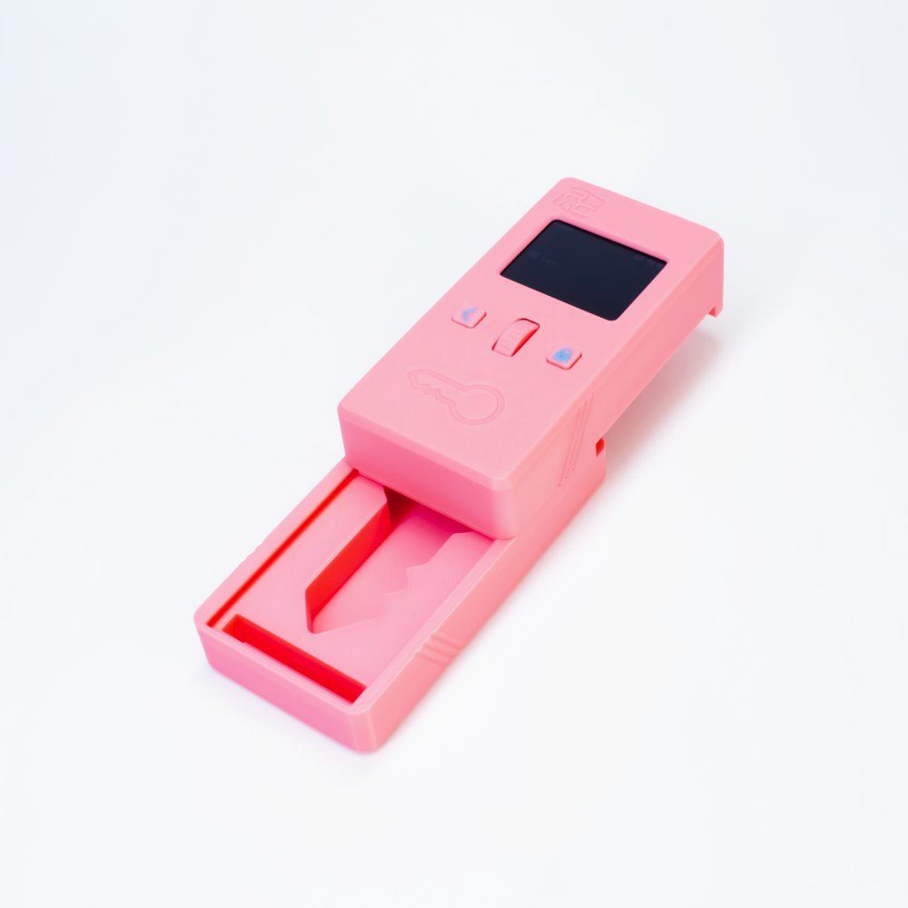

# Chastity Lockbox

<p align="center">
  <a href="https://www.researchanddesire.com/products/lockbox">
    
  </a>
</p>

<p align="center">
  <a href="https://www.researchanddesire.com/products/lockbox"><b>Get the Chastity Lockbox</b></a><br>
  Black Friday: use code <code>BLACK_FRIDAY_2026</code> at checkout.
</p>

Open-source ESP32-S3 smart lock firmware (MPL 2.0) and hardware designs (CERN-OHL-S v2).

| Resource | Location |
| -------- | -------- |
| User guides | [docs.researchanddesire.com/lockbox](https://docs.researchanddesire.com/lockbox/) |
| Developer docs | [dev.researchanddesire.com/lockbox](https://dev.researchanddesire.com/lockbox/) |
| Assembly docs | [assembly-docs/](assembly-docs/) |
| PCB hardware | [hardware/pcb/](hardware/pcb/) |
| Firmware releases | R+D firmware control plane (Supabase Storage); no GitHub Pages |

## Build

Software lives in [`software/`](software/): the PlatformIO project in
[`software/firmware/`](software/firmware/), tooling in [`software/scripts/`](software/scripts/),
and local fixture services in [`software/dev/`](software/dev/).

```bash
cd software/firmware
pio run -e development-r8                  # or development-r2 for the R2 board
pio run -e production-r2 -e production-r8  # release profiles
pio test -e test                           # native unit tests
```

See [CONTRIBUTING.md](CONTRIBUTING.md) and [developer-docs/](developer-docs/).

## Branches and releases

Feature work branches from `staging` and returns to `staging` by pull request; `staging` is promoted to `main`. Each firmware change merged to `staging` or `main` publishes an immutable, validating release candidate to the R+D firmware control plane. Devices update only through that control plane. This repository replaces the retired `__legacy_Lockbox` repository.

## License

See [LICENSE](LICENSE).
