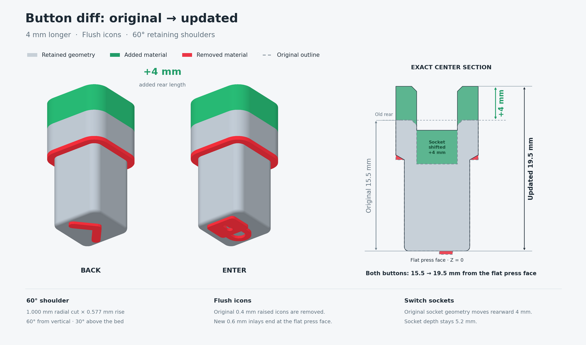

# Lockbox CAD

This directory contains STEP exports from the Lockbox Onshape document. Each file is a single exported component named with the assembly BOM slug style.

**Button revision under review:** the revised models are supplied in
[`lockbox-buttons-plus4mm-flush-step.zip`](lockbox-buttons-plus4mm-flush-step.zip).
The canonical `back-button.step` and `enter-button.step` files still contain the
previous revision. **Before merge, upload the revised STEP payloads to Git LFS
and update those two canonical paths.**

## Assembly STEP files

- `lockbox-assembly.step`

## Component STEP files

- `back-button.step`
- `battery.step`
- `bottom-housing.step`
- `encoder-wheel.step`
- `encoder.step`
- `enter-button.step`
- `lockbox-stand.step`
- `locking-latch.step`
- `motor-clamp.step`
- `motor.step`
- `part-13.step`
- `pcb-cover.step`
- `pcb-spacer-washer.step`
- `pcb.step`
- `screen.step`
- `top-housing.step`

## Revised buttons for shorter switches

The replacement switches are 4 mm shorter. This review revision extends both
buttons and prepares their press faces for multicolor face-down printing.

| File | Contents |
| --- | --- |
| [Revised STEP payloads](lockbox-buttons-plus4mm-flush-step.zip) | Both revised STEP models, a README and `SHA256SUMS`. |
| [Multipart 3MF](lockbox-buttons-plus4mm-flush.3mf) | Both buttons, face down, with separate body and icon parts. |
| [Geometry comparison](lockbox-shoulder-diff.png) | Exact original-to-updated geometry diff with body heights. |

### Geometry

- Press-face-to-rear length increases from **15.5 mm to 19.5 mm**.
- Each original switch socket moves rearward exactly **4 mm**. Its floor moves
  from **10.3 mm to 14.3 mm** from the press face; its **5.2 mm depth**, profile
  and entry chamfer are preserved.
- The lock and back icons become separate **0.6 mm-deep inlay bodies**, flush
  with the press faces at **Z = 0**.
- Each retaining shoulder receives a **60° chamfer from the vertical wall**,
  equivalent to **30° above the bed**. The cut spans **1.000 mm radially** and
  **0.57735 mm axially**, from **Z = 10.800 to 11.37735 mm**.
- Revised STEP models retain the original assembly coordinates.

For a given opening clearance, this chamfer shifts the contact point less than
a 45° chamfer over the same radial step. Its shallower surface creates a more
demanding overhang, so the housing fit and print settings still need checking.

### Printing and validation

Open the 3MF as multipart models. Both press faces are already on the bed. Its
colors are generic per-part colors; map the body and icon parts to the intended
filaments in the slicer.

CAD solids and exported meshes passed validation. The socket translation was
verified against the original geometry, and STEP exports were reimported
successfully. **Printing and physical fit have not been tested.**

### Original-to-updated comparison

Green shows added material, red shows removed material, and gray shows retained
geometry. Both body heights are measured from the flat press face at **Z = 0**;
the original **0.4 mm raised icons** are shown separately. The comparison
includes the extension, shifted sockets, shoulder chamfers and icon changes.
