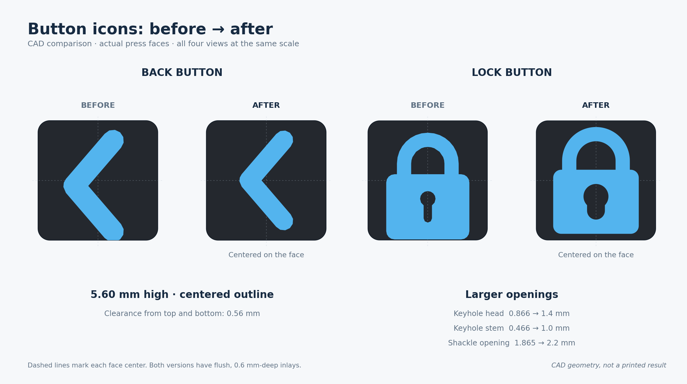

# Lockbox CAD

This directory contains the Lockbox assembly and component STEP models, named with the assembly BOM slug style.

## Buttons for shorter switches

Both buttons are **4 mm longer (15.5 → 19.5 mm)**, with flush icons and **60° retaining-shoulder chamfers measured from vertical**. The socket profile and 5.2 mm depth are retained.

Revised after the P2S test: centered arrow, centered lock, and larger lock openings—**1.4 mm keyhole head, 1.0 mm stem, 2.2 mm shackle opening**.

[Print (3MF)](lockbox-buttons-plus4mm-flush.3mf?raw=true) · [Back (STEP)](back-button.step?raw=true) · [Enter (STEP)](enter-button.step?raw=true) · [Height/shoulder diff](lockbox-shoulder-diff.png)

The 3MF places both buttons face down with separate body/icon parts; assign their filaments in the slicer. CAD and mesh checks passed. This icon revision has not been reprinted.

## Assembly STEP files

- `lockbox-assembly.step`

## Component STEP files

- `back-button.step`
- `battery.step`
- `bottom-housing.step`
- `encoder-wheel.step`
- `encoder.step`
- `enter-button.step`
- `lockbox-stand.step`
- `locking-latch.step`
- `motor-clamp.step`
- `motor.step`
- `part-13.step`
- `pcb-cover.step`
- `pcb-spacer-washer.step`
- `pcb.step`
- `screen.step`
- `top-housing.step`
