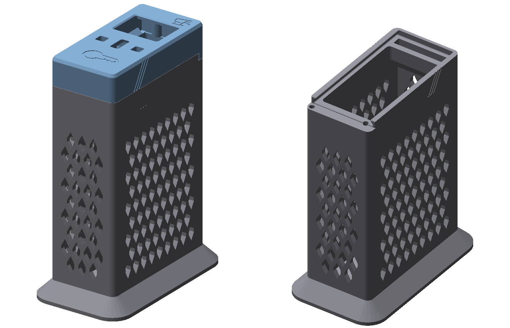
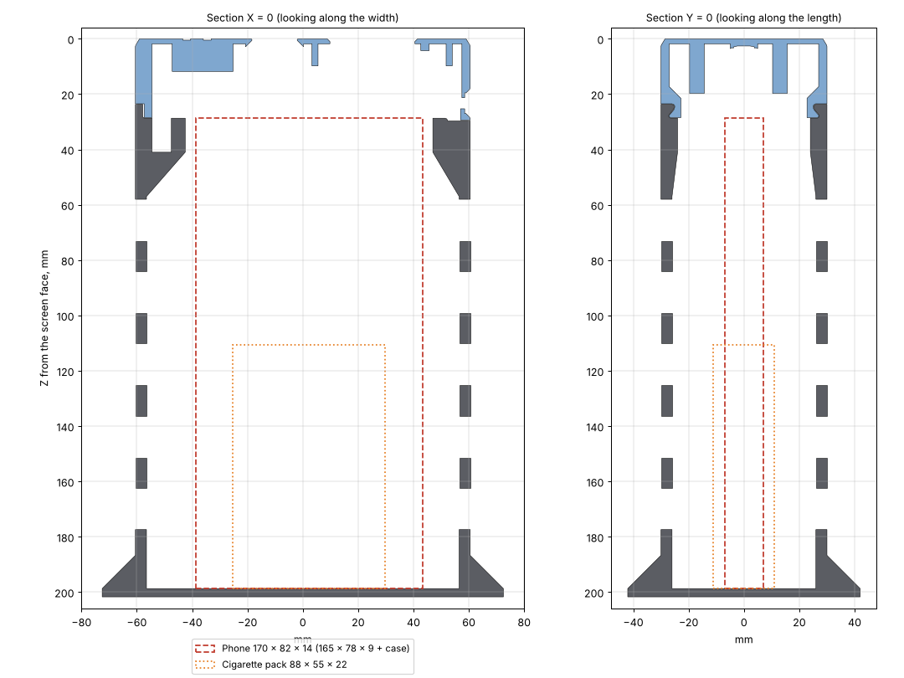
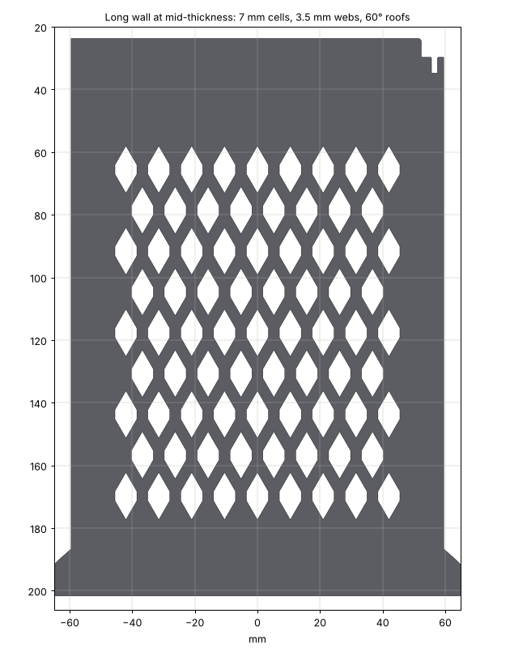

# Phone vault

A tall bottom housing whose lower cavity takes a large phone or a king-size
cigarette pack, behind honeycomb windows that print without supports.
The top of the part is the original `bottom-housing.step`, unchanged, so the
stock top housing slides on, latches and detects it exactly as before.







## Dimensions

| | mm |
| --- | --- |
| Overall height (vault alone, as printed) | 178.5 |
| Height with the top housing on | about 202 |
| Wall footprint | 60 x 121, the same as the original |
| Base foot footprint | 84 x 145 |
| Opening through the lock interface | 48 x 89.5 |
| Cavity below the opening | 52 x 113 |
| Usable depth, slide-channel floor to cavity floor | 170 |
| Honeycomb cells | 7 wide, 3 mm vertical sides, 60 degree roofs and floors |
| Webs between cells | 3.5 (vertical and slanted), through the 4 mm wall |

The cavity is sized for a 165 x 78 x 9 mm phone in a case (a 170 x 82 x 14
envelope), standing on end, which covers the largest current phones (about
163 x 78 mm), and for an 88 x 55 x 22 mm king-size pack standing on end. Both
pass the opening. Seven-millimetre cells keep a single cigarette (7.8 mm) from
being pulled out. The honeycomb replaced an earlier set of full-height bars,
which were easy to snap by hand: every web is now short, 3.5 mm thick and tied
into the lattice on both ends.

## What changed against the original bottom housing

- Everything above `CUT_Z` (Z 41, the floor of the latch slot) is the
  original part: the slide rails, the latch slot, the front magnet pocket and
  the end stop. The build checks that nothing there changes except the
  opening, the back magnet pocket and two fills, and that the top housing,
  locking latch and PCB cover overlap the vault no more than the original
  (they do not overlap either).
- The key tray is replaced by an opening into the vault, then a transition
  out to 4 mm walls. No transition face is flatter than 45 degrees.
- **The back magnet now goes in from the top**, in a pocket the same size and
  depth as the front magnet pocket (4.35 mm diameter, floor at Z 34.75), at the
  same XY as before. The original pressed it in from the underside, which the
  vault closes. It sits as close to the top housing as before or closer.
  Install it south side up, as the assembly guide says.
- The old bore under that magnet and the stand clip slot are filled; below the
  cut they would have been sealed voids. The stand does not fit this part.
- The rubber feet glue onto the flat base; there are no recesses, so the bed
  face has no bridges.

## Printing

Print upright on the base, opening up: the same way up as the original bottom
housing, so the rail hooks print as they always have. Below the interface
every downward-facing surface is at most 45 degrees from vertical (the build
measures 0 mm² steeper); each honeycomb cell has vertical sides and pointed
60 degree roofs, and the foot is a 45 degree chamfer. No supports are needed. It fits the P1S, X1C and
A1 (256 mm Z) and, at 178.5 mm tall, the A1 mini (180 mm Z).

## Regenerating

`build_freecad.py` builds `phone-vault.FCStd` (a `Params` spreadsheet drives
the features by expression, every sketch is fully constrained) and writes
`hardware/cad/phone-vault.step` (housing frame) and
`hardware/cad/phone-vault-print.stl` (base on Z = 0). Both exports are
gitignored.

```
LKBX_CAD_DIR=/path/to/real/step/files freecadcmd build_freecad.py
```

`LKBX_CAD_DIR` must hold real copies of `bottom-housing.step`,
`top-housing.step` and `lockbox-assembly.step` when the Git LFS copies are not
checked out. The honeycomb layout is generated by the script; rerun it after
changing `HEX_W`, `HEX_SIDE`, `WEB`, `ROOF_ANGLE` or the window limits.
