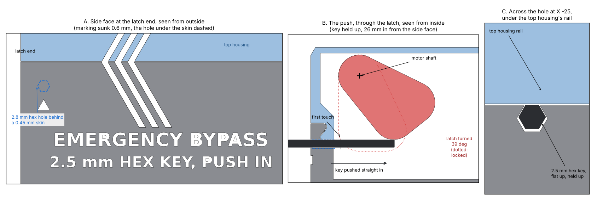

# Phone vault

A tall bottom housing whose lower cavity takes a large phone or a king-size
cigarette pack, behind honeycomb windows that print without supports.
The top of the part is the original `bottom-housing.step`, unchanged apart
from an emergency key hole, so the stock top housing slides on, latches and
detects it exactly as before. The original's emergency escape, a plug in the
floor under the latch, is covered by the vault, so it has its own bypass: a
2.5 mm hex key pushed straight in through a marked hole in the side wall
turns the latch out.


## Dimensions

| | mm |
| --- | --- |
| Overall height (vault alone, as printed) | 178.5 |
| Height with the top housing on | about 202 |
| Wall footprint | 60 x 121, the same as the original |
| Base foot footprint | 84 x 145 |
| Opening through the lock interface | 48 x 89.5 |
| Cavity below the opening | 52 x 113 |
| Usable depth, slide-channel floor to cavity floor | 170 |
| Honeycomb cells | 7 wide, 3 mm vertical sides, 60 degree roofs and floors |
| Webs between cells | 3.5 (vertical and slanted), through the 4 mm wall |
| Emergency key hole | 2.8 hex across flats, through the 7 mm side wall at the latch |
| Skin over the key hole | 0.45 (one extrusion line) |

The cavity is sized for a 165 x 78 x 9 mm phone in a case (a 170 x 82 x 14
envelope), standing on end, which covers the largest current phones (about 163
x 78 mm), and for an 88 x 55 x 22 mm king-size pack standing on end. Both pass
the opening. Seven-millimetre
cells keep a single cigarette (7.8 mm) from being pulled out. The honeycomb
replaced an earlier set of full-height bars, which were easy to snap by hand:
every web is now short, 3.5 mm thick and tied into the lattice on both ends.

## What changed against the original bottom housing

- Everything above `CUT_Z` (Z 41, the floor of the latch slot) is the
  original part: the slide rails, the latch slot, the front magnet pocket and
  the end stop. The build checks that nothing there changes except the
  opening, the back magnet pocket, two fills, the key hole and the marking,
  and that the top housing, locking latch and PCB cover overlap the vault no
  more than the original (they do not overlap either).
- The original's escape plug sat just below `CUT_Z`, under the latch, so the
  vault replaces it with the emergency bypass described below.
- The key tray is replaced by an opening into the vault, then a transition
  out to 4 mm walls. No transition face is flatter than 45 degrees.
- **The back magnet now goes in from the top**, in a pocket the same size and
  depth as the front magnet pocket (4.35 mm diameter, floor at Z 34.75), at the
  same XY as before. The original pressed it in from the underside, which the
  vault closes. It sits as close to the top housing as before or closer.
  Install it south side up, as the assembly guide says.
- The old bore under that magnet and the stand clip slot are filled; below the
  cut they would have been sealed voids. The stand does not fit this part.
- The rubber feet glue onto the flat base, with no recesses.

## Emergency bypass



The original bottom housing has an escape that is not in the assembly guide: a
plug in the floor under the latch slot, cut free by 0.3 mm slits and held only
by the first printed layer. The vault covers that floor, so it has its own
bypass instead: a hex hole for a 2.5 mm hex key, straight through the side
wall into the latch slot.

- The hole is in the long side at the latch end, at the latch's free edge,
  right under the seam with the top housing. Its top flat is level with the
  floor of the groove the top housing's rail slides in, so a key in it passes
  just under the rail (0.15 mm clear) and meets the latch low down, level
  with its lower corner.
- It is a hexagon 2.8 mm across flats with a flat on top, so a 2.5 mm key
  goes in flat side up and cannot turn, and runs 6.5 mm through the wall
  into the latch slot.
- A 0.45 mm skin (one extrusion line) closes it on the outside. The key
  punches through it, so a used bypass shows.
- The side face is marked EMERGENCY BYPASS / 2.5 mm HEX KEY, PUSH IN, with a
  pointer under the hole, sunk 0.6 mm.

To use it, stand the box on its base and find the marking, on the long side
near the latch end, just under the top housing:

1. Hold a 2.5 mm hex key by its short arm, put the end of the long arm on the
   skin above the pointer with a flat side up, and push it through.
2. Push it straight in, level and lifted against the top of the hole, until
   about 26 mm of it is inside. It bears on the latch's side low down and
   turns the latch up out of its slot, back-driving the motor. From there on
   the latch sits on top of the key, so pushing further does no harm.
3. Hold the key there, still level, and slide the top housing off.

The hole is 0.3 mm looser than the key, so a key tipped down at its end
turns the latch less; hold it level.

Once the skin is broken the hole stays open, so print a new vault.

Why a straight push into the side of the latch works where a push from below
does not: the latch hangs from the motor shaft, so a push across it, low on
the latch and far from the shaft, turns it with a long lever. A push straight
up under its tip, like a rod's up through the vault, turns it with a short
lever, while the friction of the tip sliding across the pusher works against
it with a long one, and it jams.

The build simulates the key's push on the latch's real section (pivot fitted
to its shaft bore) with friction, for the key held up against the top of the
hole and for one resting on its bottom:

| Key | Latch turned | Jams above friction |
| --- | --- | --- |
| 2.5 mm hex, flat up, held up against the top of the hole | 38.7 deg | 0.87 |
| 2.5 mm hex, flat up, resting on the bottom of the hole | 37.0 deg | 0.71 |

A steel key on the PLA latch slides at a friction coefficient under 0.5 (PLA
on PLA is about 0.3 to 0.5), so the push does not jam even with the key
resting; the build requires 0.7. The top housing slides off without touching
the far slot wall once the latch is turned 38.5 degrees, which the held-up key
reaches. Left resting, the key turns it 37.0 degrees and the latch dips
0.25 mm below the far wall's top; it rides over that on its 1 mm chamfered
edge. The build also checks that the key's way in, behind the skin and on
past the latch, is clear of everything but the latch at both heights. The
model leaves out the motor: how hard the gearbox is to turn backward is the
one thing to find out on the bench.

### Test piece

`phone-vault-escape-test-print.stl` is the top of the vault down to the end of
the transition, 60 x 121 x 33.3 mm: the whole lid interface with the latch
slot, key hole and marking. It is oriented like the vault, cut face on the
bed, and needs no supports. Print it before the vault, and with the real top
housing check that:

1. the top housing slides on, locks and reports the backplate as before
   (fit the magnets first),
2. a 2.5 mm hex key punches through the skin without a hammer, and
3. with the box locked, the key turns the latch out and the top housing then
   slides off. Note how hard the motor is to turn backward.

If the latch does not come far enough out to slide off, the fallback is a
small chamfer on the top edge of the latch slot's far wall.

## Printing

Print upright on the base, opening up: the same way up as the original bottom
housing, so the rail hooks print as they always have. Below the interface
every downward-facing surface is at most 45 degrees from vertical (the build
measures 0 mm² steeper); each honeycomb cell has vertical sides and pointed
60 degree roofs, and the foot is a 45 degree chamfer. No supports are needed. It fits the P1S, X1C and
A1 (256 mm Z) and, at 178.5 mm tall, the A1 mini (180 mm Z).

The only bridges are short: the key hole's flat top spans 1.6 mm, and the
layer above the sunk marking spans its 0.6 mm deep strokes. The skin over the
key hole is 0.45 mm, one line with a 0.4 mm nozzle; keep the Arachne wall
generator (the Bambu default) so the slicer prints it rather than dropping
it, and check in the preview that it is there.

## Regenerating

`build_freecad.py` builds `phone-vault.FCStd` (a `Params` spreadsheet drives
the features by expression, every sketch is fully constrained) and writes
`hardware/cad/phone-vault.step` (housing frame),
`hardware/cad/phone-vault-print.stl` and
`hardware/cad/phone-vault-escape-test-print.stl` (base on Z = 0). The
exports are gitignored.

```
LKBX_CAD_DIR=/path/to/real/step/files freecadcmd build_freecad.py
```

`LKBX_CAD_DIR` must hold real copies of `bottom-housing.step`,
`top-housing.step` and `lockbox-assembly.step` when the Git LFS copies are not
checked out. The honeycomb layout is generated by the script; rerun it after
changing `HEX_W`, `HEX_SIDE`, `WEB`, `ROOF_ANGLE` or the window limits. The
bypass is driven by the `KEY_*`, `LATCH_SLOT_X0` and `MARK_DEPTH` parameters; the marking
text, pointer and arrow, the key sizes and the check limits are constants
near the top of the script.
