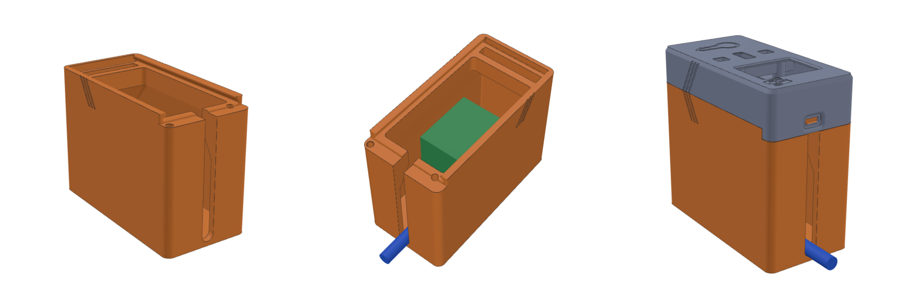
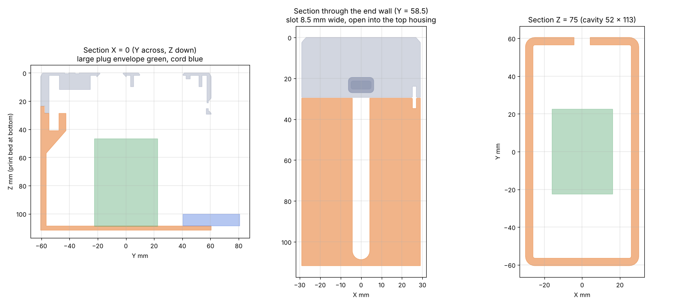

# Plug lockout

A bottom housing whose lower cavity takes the wall plug of an appliance, with
the cord running out through a slot in the end wall. The slot is wider than
the cord and narrower than any plug body, so while the top housing is locked
on, the plug stays inside and the appliance cannot be plugged in. The top of
the part is the original `bottom-housing.step`, unchanged apart from the
slot, so the stock top housing slides on, latches and detects it exactly as
before.





## Use

1. With the box unlocked and the top housing off, drop the plug into the
   cavity through the opening and slide the cord down the slot until it sits
   at the bottom, level with the cavity floor.
2. Slide the top housing on and lock it. The top housing closes the upper end
   of the slot.

## Dimensions

| | mm |
| --- | --- |
| Height (part alone, as printed) | 88.5 |
| Height with the top housing on | about 112 |
| Footprint | 60 x 121, the same as the original |
| Opening through the lock interface | 48 x 89.5 |
| Cavity below the opening | 52 x 113 |
| Usable depth, slide-channel floor to cavity floor | 80 |
| Cord slot | 8.5 wide, from the slide-channel floor down to the cavity floor, at the USB end |

## Why these numbers

The slot sits on the end wall under the USB port because the long walls carry
the slide rails at the top, and a slot there would cut a rail. The latch end
keeps its wall whole.

The slot has to be wide enough for the cord and narrower than the thinnest
way a plug can be turned to fit through it (US NEMA 1-15 and 5-15 assumed):

| | mm |
| --- | --- |
| 18/3 SJT round cord (lamps, small appliances) | about 7.4 |
| 16/3 SJT round cord (heaters, vacuums, power tools) | about 8.0 to 8.4 |
| Flat SPT-2 lamp cord | about 4 x 8.5, passes on edge |
| **Slot** | **8.5** |
| Thinnest plug bodies (flat, low profile) | about 9.5 to 11 |
| Ordinary molded plugs | 15 to 30 |

Cords heavier than 16 AWG (14/3, about 9.5 mm) do not fit. Raise `SLOT_W` in
the `Params` sheet for those, keeping it below the thickness of the plug you
want to hold. FDM slots usually print 0.1 to 0.2 mm narrow, which only makes
the plug side safer; check that the cord slides in before relying on it.

The cavity takes a 62 x 45 x 32 mm envelope (a large heater or vacuum plug,
blades included) standing on the floor, and a 46 x 40 x 24 mm right-angle
plug; both pass the opening. Plugs with a built-in GFCI or ALCI block (hair
dryers) are usually larger than the 48 mm opening and do not fit.

The slot opens the cavity to the outside, as the phone vault's windows do.
It gives no new reach to the latch, which sits behind a separate wall at the
other end.

## What changed against the original bottom housing

- Everything above `CUT_Z` (Z 41, the floor of the latch slot) is the
  original part except the opening, the cord slot, the back magnet pocket and
  two fills. The build checks this, and checks that the top housing, locking
  latch and PCB cover overlap the part no more than the original (they do not
  overlap either).
- The key tray is replaced by an opening into the cavity, then a transition
  out to 4 mm walls. No transition face is flatter than 45 degrees.
- **The back magnet goes in from the top**, in a pocket the same size and
  depth as the front magnet pocket, at the same XY as before, the same as the
  phone vault. Install it south side up, as the assembly guide says.
- The old bore under that magnet and the stand clip slot are filled; below
  the cut they would have been sealed voids. The stand does not fit this part.
- The base is flat for glued rubber feet.

## Printing

Print upright on the base, opening up, the same way up as the original bottom
housing. Below the interface no downward-facing surface is steeper than 45
degrees (the build measures 0 mm²) and the slot's rounded end faces up, so no
supports are needed. At 88.5 mm tall it fits every Bambu printer, including
the A1 mini.

## Regenerating

`build_freecad.py` builds `plug-lockout.FCStd` (a `Params` spreadsheet drives
the features by expression, every sketch is fully constrained) and writes
`hardware/cad/plug-lockout.step` (housing frame) and
`hardware/cad/plug-lockout-print.stl` (base on Z = 0). Both exports are
gitignored.

```
LKBX_CAD_DIR=/path/to/real/step/files freecadcmd build_freecad.py
```

`LKBX_CAD_DIR` must hold real copies of `bottom-housing.step`,
`top-housing.step` and `lockbox-assembly.step` when the Git LFS copies are not
checked out.
