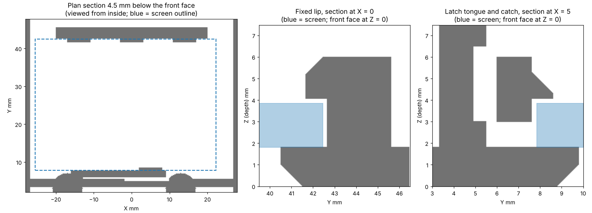

# Screen snap-fit

The 2.0 in TFT is currently hot-glued into the `top-housing` against two
locating ribs. This variant holds it mechanically: the screen hooks under
three fixed lips on its top edge, then its bottom edge presses down over one
flexing latch tongue and clicks in. No glue.

- `build_top_housing_snap_fit.py` applies the change to the Onshape export
  `../top-housing.step` and writes `../top-housing-snap-fit.step` for test
  printing. Run it with CadQuery 2.x (`pip install cadquery`); the output is
  not tracked.
- `snap-fit-sections.png` shows a plan section of the pocket and a section
  through a lip and through the latch.

`top-housing.step` is untouched. Once a test print is approved, carry the
dimensions below into the Onshape part and re-export `top-housing.step`; the
assembly guide keeps the hot-glue step until then.

## Designed for FDM

Everything here is sized for a 0.4 mm nozzle printing PLA with the front
face on the bed, and only one feature flexes.

- The three top lips are solid and never move. They are 3 mm deep and reach
  1.0 mm over the back of the screen. The 1.0 mm overhang under each lip
  prints without support.
- The single latch tongue is 1.6 mm thick (four perimeters) and 22 mm long,
  anchored at one end. It bends sideways in the print plane, so the stress
  runs along the extruded perimeters rather than across layer lines. Upright
  hooks in a pocket this shallow would be under 3 mm tall and would snap at a
  layer line.
- The tongue stands on a 1.2 mm gap above the front skin so it is free to
  bend. The slicer bridges that gap in one pass.
- Clearances are 0.2 to 0.25 mm, inside normal FDM variation. Nothing relies
  on a 0.1 mm fit.
- The catch has a 45 degree lead-in and a 0.3 mm vertical land, so it prints
  cleanly and holds by geometry, not friction.
- The cross wall behind the tongue is relieved 0.6 mm so the tongue has room
  to flex, and that wall also acts as an over-flex stop: the tongue cannot
  bend far enough to yield.

Peak bending strain in the tongue is about 0.7 % at full deflection and
0.8 % at the over-flex stop, well inside PLA's elastic range. Push-in force
is about 2 N.

## Dimensions

Housing STEP frame: Z is depth from the front face, Y runs along the housing
and X across it. Screen seated at Y 7.85 to 42.45, rear face at Z 3.85,
inner face of the front skin at Z 1.80.

| Feature | Value |
| --- | --- |
| Lip and catch underside | Z 4.05 (0.20 mm above the back of the screen) |
| Feature top | Z 6.00 |
| Top rib | Existing rib (X ±20, Y 42.65 to 45.65) raised from Z 4.30 to 6.00 |
| Lips | Three, X -17 to -11, -3 to 3 and 11 to 17; reach to Y 41.65 (1.0 mm over the screen); 0.8 mm 45 degree chamfer on the inner top edge |
| Latch face | Y 7.60 (0.25 mm from the screen edge) |
| Tongue | 1.6 mm thick (Y 6.00 to 7.60), Z 3.00 to 6.00, X -13 to 9, anchored by a block at X -16 to -13 that ties into the left cover-screw boss and the cross wall |
| Catch | X 2 to 8, 0.75 mm over the screen (tip at Y 8.60), 0.3 mm land, 45 degree lead-in |
| Wall relief | Cross wall face (Y 5.50) cut back 0.6 mm over X -2 to 10, Z 3.0 up; tongue travel 1.1 mm, required travel 1.0 mm |

Checked against `lockbox-assembly.step`: the seated screen has no
interference with the new features, and none of the other assembly parts
touch them. Lifted, the screen meets only the lips and the catch. Tilted 7
degrees or more with its top edge under the lips, the bottom edge clears the
catch tip.

## Printing

- Print face down on the smooth PEI bed as today. No supports.
- Check the slicer preview at the layer 3.0 mm from the bed: the tongue
  should appear as a free-standing 1.6 mm wall with a gap under it, bridged
  from the anchor block. If the slicer fills the gap, the tongue will not
  flex.
- At 0.2 mm layers the lip and catch undersides land on the 4.0 mm layer.
  If the screen rattles, lower `RETAIN_Z` by 0.1 mm. If it is hard to seat,
  reduce `CATCH_OVERLAP` to 0.6 mm first; thin the tongue only as a last
  resort.

## Assembly

1. Remove the protective film and hold the screen face down with the ribbon
   toward the housing wall.
2. Slide the top edge of the screen under the three lips, with the bottom
   edge raised.
3. Press the bottom edge down near the middle until the latch clicks.
4. Apply the battery to the rear of the screen as before.

To remove the screen, push the free end of the tongue (right of the catch)
back toward the encoder with a plastic spudger and lift the bottom edge of
the screen, then slide it out from under the lips.

## Test print checklist

- Gap under the tongue is open and the tongue flexes by hand.
- Screen slides under the lips and clicks down onto the latch.
- No rattle when the housing is shaken.
- The battery still fits on the rear of the screen and the PCB seats without
  touching the lips or tongue.
- The screen can be removed and reinstalled a few times without the tongue
  cracking or taking a set.
