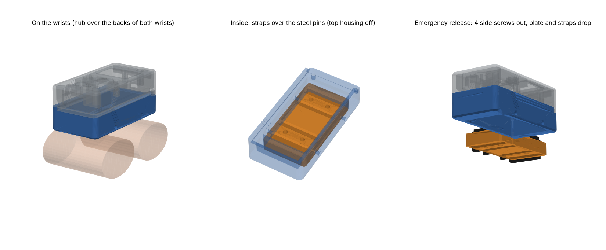
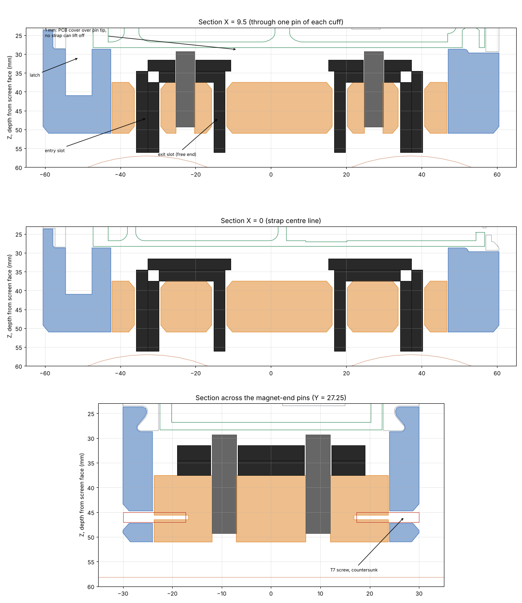

# Wrist restraints

A pair of soft wrist cuffs held together, and held closed, by a lockbox. The
whole lockbox core is reused unchanged: top housing, PCB, screen, battery,
motor, locking latch, buttons, encoder and magnets. Only the bottom housing
is replaced, by two printed parts:

- **Cuff dock** (`CuffDock`): the original bottom housing above Z 41 (slide
  rails, latch slot, magnet pockets), with the key tray opened straight
  through and a 10 mm skirt below. The stock top housing slides on, latches
  and detects it exactly as before, so the firmware needs no change.
- **Cuff plate** (`CuffPlate`): fills the dock from below and carries four
  steel pins. Each cuff strap comes up through an entry slot, lies flat over
  two pins, and its free end goes back down through an exit slot. With the
  top housing on, the PCB cover sits 1 mm above the pin tips, so a strap
  cannot lift off its pins: neither cuff can be loosened or opened until the
  lockbox unlocks and the top housing slides off.

Four T7 screws through the long sides hold the plate in the dock. Taking
them out drops the plate, both straps and the cuffs out of the bottom. That
is the emergency release, and it needs no battery, motor or firmware.





## Safety

This holds a person, so read this before building or using it.

- **The lock stays locked with a flat battery.** The gear motor does not
  back-drive, so a dead battery, a crashed firmware or a lost connection
  leaves the cuffs locked. The screw-out release and safety shears are the
  answer to that, not the electronics. Charge the lockbox fully before a
  session.
- **Keep a T7 driver and a pair of EMT (trauma) shears within the partner's
  reach for the whole session.** The shears cut either strap in one snip
  where it leaves the hub; that is the fastest release in an emergency.
- **Never leave the restrained person alone**, and do not use it for
  self-bondage. Every release (timer, screws, shears) needs free hands.
  The firmware's emergency unlock also needs the buttons, which a
  restrained wearer may not reach.
- **Fit with two fingers** under each cuff. Check hands every 10 to 15
  minutes: coldness, numbness, tingling, pins and needles or colour change
  means release now, not at the end of the timer.
- **It is for light play, not for load.** The hub is printed plastic. Do not
  suspend from it, tie it to a fixed point, or use it where the wearer will
  struggle hard. Hands behind the back strain the shoulders and nerves
  sooner than in front; keep those sessions short.
- Agree on a safeword (and a non-verbal signal) before starting.

## Parts

| Part | Qty | Notes |
| --- | --- | --- |
| Lockbox core | 1 | Everything except the bottom housing and the stand, built per the assembly guide |
| Cuff dock | 1 | Printed, `cuff-dock-print.stl` |
| Cuff plate | 1 | Printed, `cuff-plate-print.stl` |
| Steel dowel pin, 5 x 20 mm | 4 | Pressed into the plate |
| #4-20 x 1/2 in 6-lobe flat screw | 4 | The same screw as the motor clamp and PCB cover, driven with the same T7 driver |
| 4 mm x 5 mm N52 magnet | 2 | Front and back magnet of the dock, as in the original bottom housing |
| Strap, 38 mm (1.5 in), 1.2 to 3 mm thick | 2 x about 380 mm | Biothane is easy to clean and does not stretch; vegetable-tanned leather also works |
| Padded cuff sleeve | 2 | About 60 to 70 mm wide, 5 to 6 mm neoprene or fleece-lined leather, with two loops the strap threads through |
| EMT safety shears and a T7 driver | 1 each | Required for every session |

## Making the straps

Each strap has a **fixed end** and a **free end**, with holes in pairs 19 mm
apart (centred across the strap) for the two pins.

1. Punch the fixed end's hole pair 12 mm from that end, 5.5 mm holes.
2. Measure the wrist circumference C. Punch free-end hole pairs at about
   C + 95 mm from the fixed pair, and every 10 mm from there in both
   directions to cover the wrists that will use it. For wrists from 14 to
   21 cm, that is pairs from 235 to 305 mm.
3. Leave 60 mm of strap past the last pair; it goes down the exit slot and
   tucks into a loop on the cuff sleeve.
4. Thread the strap through the cuff sleeve's loops.

The 95 mm figure is the path inside the hub plus 6 mm padding and a
two-finger allowance. It is a starting point: test-fit with the top housing
off before punching every pair.

## Printing and assembly

1. Print both parts in PETG or PLA at 0.2 mm layers, 4 walls, 40 percent
   infill or more. The dock prints skirt down, like the original bottom
   housing prints base down. The plate prints underside down. Neither needs
   support.
2. Glue the dock's two magnets, south side up at the back (top-entry pocket,
   as in the phone vault and plug lockout) and north side up at the front,
   as the assembly guide says for the bottom housing.
3. Press the four pins into the plate from the top until 8.2 mm stands
   proud (a vise works; the holes go through so a pin can be driven back
   out). The holes are 4.9 mm for a press fit; open them up with a 5 mm
   drill and a drop of CA glue if your printer prints them tight.
4. Push the plate into the dock from below and drive the four screws
   through the long sides until the heads sit flush.

## Use

1. With the lockbox unlocked and the top housing slid off, fit a cuff on
   each wrist, wrists side by side under the hub, backs of the wrists up.
2. For each cuff, push the free end up through the entry slot (the outer
   slot at that end), lay it over the pins on its chosen hole pair, and
   feed the rest down the exit slot (the inner slot). Then push the fixed
   end up the same entry slot on top of it and press its hole pair over the
   same pins.
3. Slide the top housing on and lock the timer as usual. The box checks the
   dock's magnets exactly as it checks the original bottom housing.
4. To release normally, let the timer unlock, slide the top housing off and
   lift the straps off the pins.

**Emergency release:** remove the four T7 screws in the sides and pull the
plate out of the bottom; the straps come with it and lift off the pins. Or
cut the straps with the shears.

## Dimensions

| | mm |
| --- | --- |
| Hub height (screen face to underside) | 51 |
| Footprint | 60 x 121, the same as the lockbox |
| Dock skirt below the top housing | 10 |
| Plate | 47.4 x 88.9 x 13.5 |
| Entry slots (both layers) | 41 x 7, 70 apart |
| Exit slots (free end) | 41 x 4, 32 apart |
| Pin rows | 50 apart, pins 19 apart across the strap |
| Pin tip to PCB cover | 1.0 |

## Why these numbers

- **Pins under the PCB cover.** The strap lies on the plate with the pins
  through it. Any strap thicker than the 1 mm gap between a pin tip and the
  PCB cover would have to pass through the cover to come off, so the cuffs
  are held by geometry, not friction. The build checks the gap at every pin
  (0.5 to 1.15 mm) and that the top housing slides off over the pins and
  straps.
- **Steel pins, not printed ones.** Printed pins standing up from the plate
  would be loaded across their layer lines and shear easily. A steel pin
  bears on the hole wall along the layers, the strong direction.
- **The latch is not in the load path.** Pulling on a cuff loads the pins,
  the plate and the four screws; the latch only keeps the top housing on,
  and the top housing only keeps the straps from lifting. The lockbox's
  latch, slide rails and motor see no more force than in the original box.
- **Screw-out plate as the release.** It is the one release that does not
  depend on the battery, motor or firmware, it uses the driver every builder
  already has, and the screws face sideways where a partner can reach them
  with the hub on the wrists. Anyone with a T7 driver can open it, which is
  the point for a restraint.
- **Entry slots outside, exit slots inside.** The cuff loops hang 70 mm
  apart, about two wrists side by side with padding. The spare free end
  hangs between the wrists, where it is out of the way and easy to cut.
- **Flared slot edges and a lower chamfer.** The strap turns 90 degrees at
  the top and bottom of each slot; the 1.5 mm flares spare it a sharp edge.
  They and the dock's lower chamfer are about 50 degrees, so they print
  without support.

## What changed against the original bottom housing

- Everything above `CUT_Z` (Z 41, the floor of the latch slot) is the
  original part except the opening, the back magnet pocket and two fills.
  The build checks this, and that the top housing, locking latch and PCB
  cover overlap the new parts no more than the original (they do not).
- The key tray becomes a 48 x 89.5 mm opening straight through, filled from
  below by the plate (0.3 mm clearance per side).
- The back magnet goes in from the top, as in the phone vault and plug
  lockout. The old bore under it and the stand clip slot are filled. The
  stand does not fit this part.

## Not yet tested

Nothing has been printed yet. Before relying on it, print both parts, check
the pin press fit, the plate fit in the dock and the screw bite, fit the
straps with the top housing off, then lock and pull firmly on each cuff.

## Rebuilding

```bash
LKBX_CAD_DIR=/path/to/real/step/files freecadcmd build_freecad.py
```

The script rebuilds `wrist-restraints.FCStd` from the `Params` spreadsheet,
runs the checks above, and writes `cuff-dock.step`, `cuff-plate.step`,
`cuff-dock-print.stl` and `cuff-plate-print.stl` into `hardware/cad/`
(gitignored; STEP and STL are Git LFS patterns).
