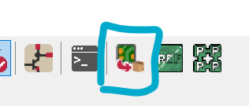
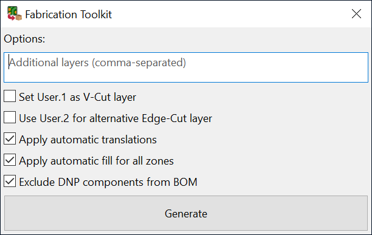

# Fabrication Output

## Setup

1. Install Fabrication Toolkit using the Plugin and Content Manager within KiCad.

## How to use

1. Within the PCB editor, click on the fabrication toolkit icon.

   

2. This will pop up a window with basic options.  The defaults should be fine for JLC, but double check against this screenshot.

   

3. It generates several files, only a few of them are necessary.

   - `LockBox_*.zip`: zipped Gerbers. Most fabricators accept the zip directly.
   - `bom.csv`: bill of materials in the JLC format, generated from the schematic `MPN` metadata.
   - `positions.csv`: component position/centroid file.
   - `designators.csv`: not needed for normal fabrication handoff.
   - `netlist.ipc`: not needed for normal fabrication handoff.
   - `Backups/`: prior generated production outputs. These are ignored by `hardware/pcb/.gitignore`.
